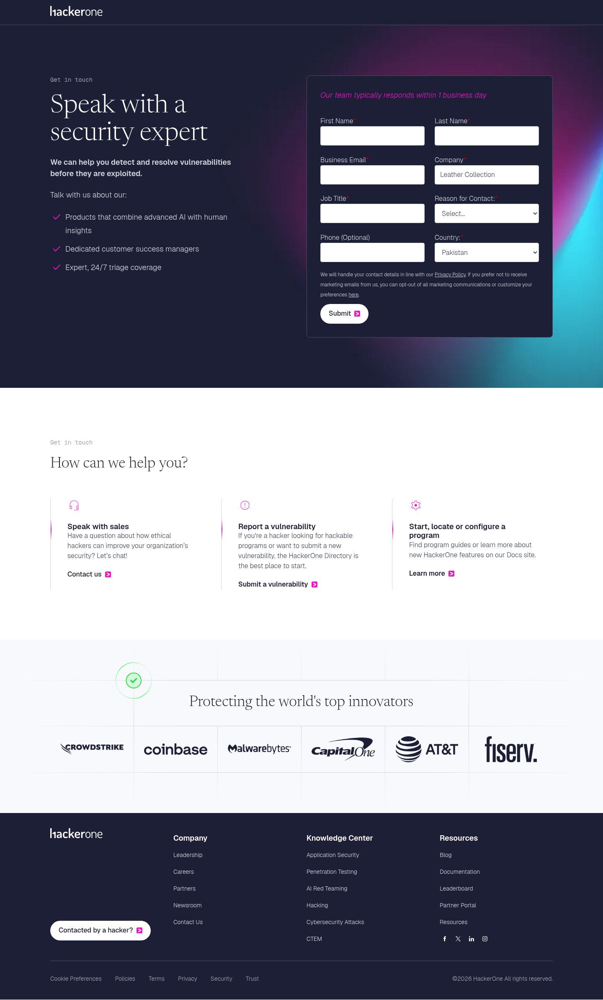

# HackerOne review and v6 completion

Reviewed 7 November 2026. Scope: HackerOne's public marketing website, platform overview, researcher introduction and contact page. This is not a review of its authenticated product.

## Public journey observations

1. **Homepage — clear primary action, broad navigation.** The hero offers a direct getting-started action and a platform explanation. Separate researcher navigation and a researcher section serve the second audience. Apply this to v6 with two immediate choices: start a program or find a program. [Source](https://www.hackerone.com/).
2. **Platform overview — connected workflow, substantial reading.** Discovery, validation and remediation are explained together. V6 should explain its own report → remediation → retest sequence, with links to the actual workspace. Keep the explanation focused on capabilities present in the project. [Source](https://www.hackerone.com/platform).
3. **Researcher introduction — a distinct starting point.** Program discovery and scope review sit alongside onboarding guidance and FAQs. V6 needs a researcher introduction, program directory and recovery guidance before its existing private intake. [Source](https://www.hackerone.com/hackers/how-to-start-hacking).
4. **Contact — useful routing beneath a demanding form.** The page separates sales, vulnerability submission and program guidance. V6 adopts that separation and uses a shorter general enquiry form. Vulnerabilities go to a program's private intake. [Source](https://www.hackerone.com/contact).

## Capture evidence and limits

[Contact capture](research/hackerone/04-contact.png) is the accepted unobstructed visual reference. The cookie notice was dismissed using its actual visible control before capture.

The home, platform and researcher captures include a persistent third-party loading panel on the right. Those captures are retained as **partial, rejected visual evidence**, not clean full-page references. Their readable page content and the linked public sources inform the journey observations above. Some scroll-triggered media also did not load in full-page captures. No performance score or visual fidelity claim is based on those captures.

Visible accessibility risks on the contact capture: small secondary copy and pink accents require measured contrast checks; the large form would benefit from checking keyboard focus, required-field announcements and validation. Screenshots alone do not establish accessibility compliance. No form was submitted and no private account was used.

## Gaps addressed in v6

The original 520 views concentrated on report workflows, case tabs, retest attempts and exception states. They did not provide a complete public website or sufficiently developed account and program-management entry points.

- **Public website:** desktop, tablet and mobile landing pages; a complete long-form desktop landing layout; platform, researcher and security-team introductions; trust explanation; program directory, filtered results and no matches; help, recovery guidance, contact and confirmation.
- **Account entry:** task choice, email verification, expired link, verified outcome and researcher welcome. Registration continues into this flow.
- **Account management:** profile, save confirmation, security and notification preferences for researcher, defender and owner contexts; researcher session revocation and password change; account menus and sign-out.
- **Notifications:** unread and read states, researcher variants and narrow layouts. The canonical report notification follows the current lifecycle rather than an old hard-coded report stage.
- **Program management:** program list, new program form, saved draft, scope editing and saved scope draft. Draft activation links into the existing domain, policy, key and recipient setup flows.
- **Mobile:** landing, program search, account navigation, profile editing and notifications. Existing report/retest mobile views remain connected.

## Visual continuity

The additions use v6's refined IBM Plex Sans typography, white work surfaces, neutral navigation, subtle borders and forest-green actions. Product settings retain the existing shell geometry. Marketing uses a larger title and a real export of the v6 report as product evidence. The report preview is an embedded raster asset; surrounding layout, text, components and interactions are native editable layers.

HackerOne's colors, promotional claims, customer logos, commercial plans and AI product suite were not adopted. The project does not yet specify a bounty marketplace, paid plans, public report feed, researcher leaderboard or managed pentesting service. Those are not represented as operating features. The program directory uses the existing Northstar fixture; the additional Mobile disclosure program is an unpublished draft.

## Prototype boundaries

Fields contain prepared values. Navigation, preference toggles and state transitions are native prototype interactions. Email delivery, contact submission, authentication, session revocation, encryption and domain verification remain represented outcomes. No backend or application code was changed for this task.

[Review all screens](index.html) · [Completion checks](completion-verification.json) · [Native source](../BugBountyTrack-Professional-v6.figcraft)
