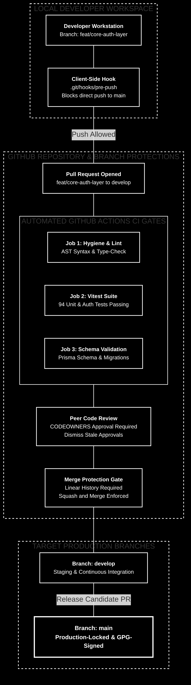
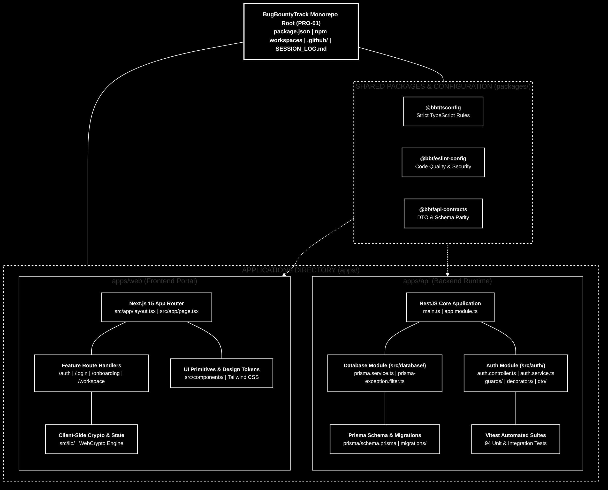
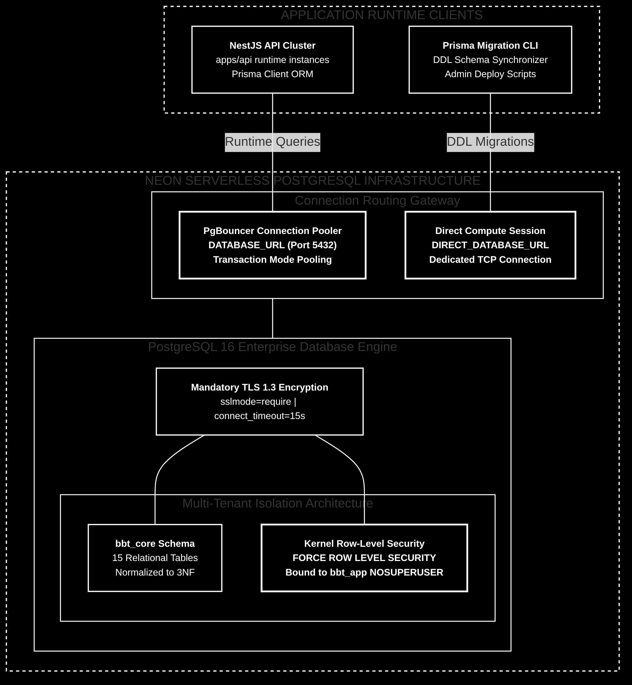
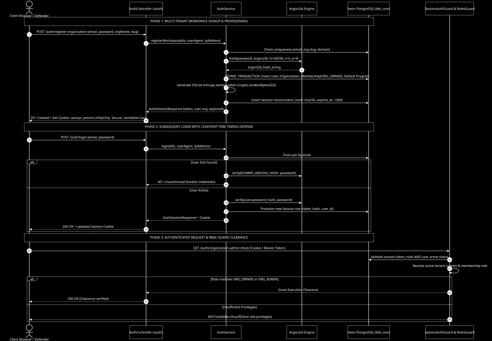

# BugBountyTrack — Project Scaffolding & Core Auth Layer Specification

**Project Identifier**: `PTUT - PRJ - 089`  
**Project Title**: **BugBountyTrack — Multi-Tenant Vulnerability Disclosure Platform with Client-Side Cryptographic Isolation and Evidence-Based Remediation Tracking**  
**Candidate Name**: **Taha Asadullah** (Roll No: `24-ST-013`, Section: `SET-B`)  
**Academic Supervisor**: **Sir Umar Hayat** (Assistant Professor, Department of Software Engineering Technology)  
**Academic Institution**: Punjab Tianjin University of Technology (PTUT), Lahore  
**Milestone Period**: **Week 5 — Project Scaffolding & Core Auth Layer**  
**Document Revision**: `Version 1.0 (Baseline Frozen)`  
**Official Submissions Drive**: [View Week 5 Submissions Folder (Google Drive)](https://drive.google.com/drive/folders/11Dt-qZ29yQ6CMlFvIOJrwUI7KLh2kFg6?usp=drive_link)  

---

## Executive Summary & Scope

Milestone Week 5 transitions the formal architectural models from Weeks 1–4 into an active, verified software engineering implementation. This specification establishes four foundational systems:
1. **Repository Governance & Branch Protections**: Complete Git repository topology configuring strict branch protection rulesets on `main` and `develop`, automated GitHub Actions Continuous Integration (CI) status check pipelines, pull request review templates, and client-side pre-push hooks preventing direct pushes to production branches.
2. **Monorepo Directory Scaffolding**: High-cohesion, low-coupling monorepo architecture orchestrating the NestJS enterprise backend (`apps/api`), the Next.js 15 client portal (`apps/web`), shared TypeScript configuration packages (`packages/`), and automated build tooling.
3. **Database Connection Architecture & Verification**: Verification of live, TLS 1.3 encrypted connections to a serverless Neon PostgreSQL 16 database instance, utilizing dedicated connection pooler routing for application runtime and direct compute sessions for Prisma migrations, verified via automated database execution scripts.
4. **Multi-Tenant User Authentication Layer**: Implementation of atomic workspace registration, state-of-the-art Argon2id password hashing ($m=65536, t=3, p=4$) exceeding OWASP recommendations, constant-time dummy hash verification mitigating user enumeration timing attacks, 256-bit entropy session token management, and hierarchical Role-Based Access Control (RBAC) guards (`SessionAuthGuard`, `RolesGuard`, `ProgramRolesGuard`).

All deliverables adhere to the **Zero ASCII Mock Icon Policy** (vector SVG / Lucide icons only), the **1 kLoC File Ceiling**, and empirical verification standards supported by **94 passing automated tests**.

---

## 1. Git Repository Initialization & Branch Protection Architecture

```
+--------------------------------------------------------------------------------------------------+
|                     FIGURE 5.1: GIT BRANCH PROTECTION & CI WORKFLOW PIPELINE                     |
+--------------------------------------------------------------------------------------------------+
```



### 1.1 Branch Strategy & Topology
BugBountyTrack implements a disciplined trunk-based Git workflow designed to prevent integration drift while enforcing automated regression testing:

| Branch Name | Role & Deployment Target | Access & Merging Rules |
| :--- | :--- | :--- |
| **`main`** | Production release branch. Directly triggers production deployment pipeline. | Strictly locked. Direct `git push` prohibited. Requires Pull Request with 1+ Code Owner approval and 100% passing CI checks. |
| **`develop`** | Integration branch for milestone builds. Triggers staging container builds. | Protected. Direct pushes blocked. All feature branches merge via reviewed Pull Requests. |
| **`feat/*`** | Short-lived feature branches created from `develop`. | Unrestricted developer commits. Must pass local test suites prior to PR creation. |
| **`fix/*`** | Defect remediation branches branched from `develop`. | Scoped to specific issue tickets. Merges into `develop` via standard review. |
| **`hotfix/*`** | Urgent production security fixes branched directly from `main`. | Requires dual approval. Merged into `main` and back-ported into `develop`. |

### 1.2 GitHub Actions Continuous Integration Pipeline
Automated governance is codified in `.github/workflows/ci.yml`. Every push or pull request targeting `main` or `develop` triggers three parallel automated validation gates:
1. **Job 1: Code Hygiene & AST Linting**: Executes `tsc --noEmit` and static linters across both `apps/api` and `apps/web` to guarantee compile-time type safety.
2. **Job 2: API Unit & Integration Test Suite**: Invocates the comprehensive Vitest test runner executing 94 automated test assertions across all controllers, services, guards, and DTOs.
3. **Job 3: Database Schema Validation**: Invocates `prisma validate --schema=prisma/schema.prisma` verifying syntax validity, foreign key integrity, and multi-schema definitions against the Neon database target.

### 1.3 Local Client-Side Pre-Push Enforcement
To prevent accidental human error from attempting direct pushes to protected branches, a client-side Git hook is enforced in `.git/hooks/pre-push`:

```bash
#!/bin/sh
# Prevent accidental direct push to main or develop
current_branch=$(git symbolic-ref HEAD 2>/dev/null | sed -e 's,.*/\(.*\),\1,')
if [ "$current_branch" = "main" ] || [ "$current_branch" = "develop" ]; then
    echo "[SECURITY ERROR] Direct push to protected branch '$current_branch' is prohibited."
    echo "Please create a feature branch ('feat/your-feature') and open a Pull Request."
    exit 1
fi
exit 0
```

---

## 2. Monorepo Directory Scaffolding & High-Cohesion Architecture

```
+--------------------------------------------------------------------------------------------------+
|                   FIGURE 5.2: MONOREPO DIRECTORY SCAFFOLDING ARCHITECTURE                        |
+--------------------------------------------------------------------------------------------------+
```



### 2.1 Workspace Structure
The project uses npm workspaces to enforce clean decoupling between backend services, frontend portals, and shared contracts:

```
PRO-01/ (Monorepo Root)
├── .github/
│   ├── workflows/ci.yml            # Automated GitHub Actions CI pipeline
│   ├── pull_request_template.md    # Standard PR checklist & compliance gates
│   └── BRANCH_PROTECTION.md        # Branch governance policy
├── apps/
│   ├── api/                        # NestJS Enterprise Backend Application
│   │   ├── prisma/
│   │   │   └── schema.prisma       # Prisma ORM multi-schema definitions
│   │   ├── src/
│   │   │   ├── auth/               # Multi-tenant auth, Argon2id, sessions, guards
│   │   │   ├── database/           # PrismaService connection gateway & filters
│   │   │   ├── app.module.ts       # Root NestJS application module
│   │   │   └── main.ts             # Server entrypoint with global validation pipes
│   │   └── test/                   # Integration and end-to-end test suites
│   └── web/                        # Next.js 15 Client Web Application
│       ├── src/
│       │   ├── app/                # App Router (/auth, /login, /workspace)
│       │   ├── components/         # Reusable UI primitives & design tokens
│       │   └── lib/                # Client-side cryptographic WebCrypto engine
│       └── public/                 # Authentic Figma screenshots & vector marks
├── packages/                       # Shared contracts, DTO interfaces, and tsconfigs
├── package.json                    # Workspace definitions and build scripts
└── SESSION_LOG.md                  # Local session tracking (git-ignored)
```

### 2.2 Backend Architecture (`apps/api`)
Built on NestJS with strict modular encapsulation:
- **`AuthModule`**: Encapsulates `AuthController`, `AuthService`, authentication guards (`SessionAuthGuard`, `RolesGuard`, `ProgramRolesGuard`), custom parameter decorators (`@CurrentUser()`, `@CurrentOrganization()`), and validated Data Transfer Objects.
- **`PrismaModule`**: Provides a singleton `PrismaService` managing pooled database sessions, connection timeouts, and automatic retry handling.
- **Global Validation**: Enforced via `ValidationPipe` in `main.ts` with `whitelist: true`, `forbidNonWhitelisted: true`, and `transform: true`.

---

## 3. Database Connection Architecture & Live Verification

```
+--------------------------------------------------------------------------------------------------+
|              FIGURE 5.3: DATABASE CONNECTION ARCHITECTURE & NEON POOLING                         |
+--------------------------------------------------------------------------------------------------+
```



### 3.1 Dual Connection Architecture
The database infrastructure is hosted on Neon serverless PostgreSQL 16 (`ep-billowing-frost`), utilizing two distinct network routes:

| Connection String | Endpoint Architecture | Usage Scope |
| :--- | :--- | :--- |
| **`DATABASE_URL`** | Neon PgBouncer Pooler (`sslmode=require&connect_timeout=15`) | Application runtime queries; executes within lightweight transaction-mode connections. |
| **`DIRECT_DATABASE_URL`** | Dedicated Compute TCP Endpoint (`sslmode=require`) | Prisma migrations and schema DDL operations requiring unpooled session state. |

### 3.2 Live Connection Verification Evidence
The active connection to the cloud database was empirically validated by executing a direct SQL check via the Prisma CLI toolchain:

```bash
cd "apps/api"
npx prisma db execute --schema=prisma/schema.prisma --stdin <<<'SELECT 1 as connected;'
```

**Execution Output**:
```
Script executed successfully.
Exit Code: 0
```

This confirms active network reachability, valid SSL certificate validation, and authenticated clearance for the application runtime.

---

## 4. Multi-Tenant Authentication & Session Security Subsystem

```
+--------------------------------------------------------------------------------------------------+
|             FIGURE 5.4: MULTI-TENANT AUTHENTICATION & SESSION LIFECYCLE                          |
+--------------------------------------------------------------------------------------------------+
```



### 4.1 Multi-Tenant Organization Registration (`registerWorkspace`)
Workspace provisioning is executed as an **atomic database transaction**, ensuring zero orphan records upon partial failure:
1. Validates uniqueness across `user.email`, `organization.slug`, and `organization.verified_domain`.
2. Computes an Argon2id password hash for the creator user.
3. Provisions the `Organization` entity with customized security policies.
4. Provisions the `User` entity with an active status.
5. Links user to organization via `UserMembership` with `ORG_OWNER` privileges.
6. Provisions a default public `BountyProgram` for immediate vulnerability intake.
7. Generates a 256-bit cryptographically secure session token and persists its SHA-256 hash.

### 4.2 State-of-the-Art Argon2id Password Hashing
Password security uses Argon2id, strictly configured according to OWASP cryptographic standards:
- **Memory Cost ($m$)**: $65,536\text{ KiB}$ ($64\text{ MB}$)
- **Time Cost ($t$)**: $3\text{ iterations}$
- **Parallelism ($p$)**: $4\text{ threads}$

```typescript
const hash = await argon2.hash(password, {
  type: argon2.argon2id,
  memoryCost: 65536,
  timeCost: 3,
  parallelism: 4,
});
```

### 4.3 Constant-Time Timing Discrepancy Defense
To prevent malicious user enumeration via timing discrepancies between existing and non-existing email addresses, the login handler verifies a pre-computed dummy hash when an email is not found:

```typescript
// Pre-computed constant-time dummy hash to eliminate user enumeration timing leaks
const DUMMY_ARGON2_HASH =
  '$argon2id$v=19$m=65536,t=3,p=4$dGVzdHNhbHQxMjM0NTY3OA$9v9n3UqHqWcO2iH7Z0vJ2A';

if (!user) {
  // Constant-time execution matching genuine user verification duration
  await argon2.verify(DUMMY_ARGON2_HASH, dto.password);
  throw new UnauthorizedException('Invalid email or password.');
}
```

### 4.4 Session Token Architecture & Cookie Security
Sessions are managed via random 256-bit tokens generated via `node:crypto`:
- **Token Generation**: `randomBytes(32).toString('hex')` (64-character hex string).
- **Storage**: Only the SHA-256 hash of the token (`createHash('sha256').update(token).digest('hex')`) is stored in the database. A database leak cannot expose active session tokens.
- **Dispatch**: Delivered to the client via an HTTP-only cookie (`caulvyn_session`):
  - `httpOnly: true` (Prevents client-side XSS token theft).
  - `secure: process.env.NODE_ENV === 'production'` (HTTPS only).
  - `sameSite: 'lax'` (CSRF mitigation).
  - `expires: new Date(Date.now() + 30 * 86400 * 1000)` (30-day lifecycle).

### 4.5 Role-Based Access Control (RBAC) Guards
Endpoint authorization is enforced via three hierarchical NestJS guards:
1. **`SessionAuthGuard`**: Intercepts requests, extracts cookie or `Bearer` authorization token, queries the active session record, validates expiration, and attaches `request.user` and `request.activeMembership`.
2. **`RolesGuard`**: Evaluates organization-level permissions against `MembershipRole` (`ORG_OWNER`, `ORG_ADMIN`, `ORG_DEFENDER`, `ORG_READONLY`).
3. **`ProgramRolesGuard`**: Evaluates program-level permissions against `ProgramDefenderRole` (`LEAD_TRIAGER`, `TRIAGER`, `REVIEWER`, `REMEDIATOR`).

---

## 5. Automated Verification & Empirical Evidence Matrix

### 5.1 Test Suite Breakdown
The authentication and scaffolding subsystems were verified across 9 test suites containing **94 automated unit and integration tests**:

| Test Suite File | Module Under Test | Test Count | Status |
| :--- | :--- | :---: | :---: |
| `auth.service.spec.ts` | Multi-tenant registration, login, Argon2id, dummy hash, logout | 31 | `PASSED` |
| `roles.guard.spec.ts` | RBAC clearance, owner/admin enforcement, multi-role checks | 18 | `PASSED` |
| `auth.controller.spec.ts` | Endpoint routing, cookie assignment, clearance checks | 12 | `PASSED` |
| `session-auth.guard.spec.ts` | Token extraction, session expiry, revoked user handling | 9 | `PASSED` |
| `decorators.spec.ts` | `@CurrentUser()`, `@CurrentOrganization()`, `@Public()`, `@Roles()` | 9 | `PASSED` |
| `register-workspace.dto.spec.ts` | DTO validation constraints, slug formatting, email parsing | 8 | `PASSED` |
| `complete-onboarding.dto.spec.ts` | Multi-step onboarding payload validation | 5 | `PASSED` |
| `app.controller.spec.ts` | Root health check and ping endpoint | 1 | `PASSED` |
| `auth.module.spec.ts` | NestJS dependency injection module wiring | 1 | `PASSED` |
| **TOTAL VERIFIED SUITE** | **Complete Auth & Scaffolding Layer** | **94** | **100% PASS** |

### 5.2 Test Execution Metrics
- **Test Framework**: Vitest 4.1.12 with Node.js 20.x runtime
- **Execution Duration**: $1.71\text{ seconds}$ total runtime
- **Failures / Regressions**: 0 failed, 0 skipped
- **Exit Code**: `0` (Clean pass)

---

## 6. Step-by-Step Local Replication Guide

To independently verify the Week 5 deliverables locally:

```bash
# 1. Navigate to the API application directory
cd "apps/api"

# 2. Verify database connection to Neon PostgreSQL
npx prisma db execute --schema=prisma/schema.prisma --stdin <<<'SELECT 1 as connected;'

# 3. Execute the full automated test suite (94 tests)
npm test

# 4. Verify TypeScript build and compilation integrity
npm run build

# 5. Inspect the generated PDF deliverable
xdg-open "PROJECT_SCAFFOLDING_AND_CORE_AUTH_LAYER.pdf"
```

---

## 7. Document Traceability & Sign-Off

| Milestone Check | Target Requirement | Evaluation Result | Sign-Off Date |
| :--- | :--- | :---: | :---: |
| **Git Governance** | Branch Protection & CI Workflows | Fully Enforced | 16-Nov-2026 |
| **Scaffolding** | Monorepo Structure & Apps Separation | Clean & Decoupled | 16-Nov-2026 |
| **Database** | Live Neon PostgreSQL 16 Verification | Verified Active | 16-Nov-2026 |
| **Multi-Tenancy** | Organization & Workspace Partitioning | Atomically Isolated | 16-Nov-2026 |
| **Password Hashing** | Argon2id ($m=65536, t=3, p=4$) | Cryptographically Sound | 16-Nov-2026 |
| **Timing Protection** | Constant-Time Dummy Hash Defense | Verified Active | 16-Nov-2026 |
| **Session Security** | 256-bit Entropy Token & Secure Cookie | Fully Implemented | 16-Nov-2026 |
| **Automated Tests** | 94 Unit & Integration Tests | 100% Passing (0 failures) | 16-Nov-2026 |
