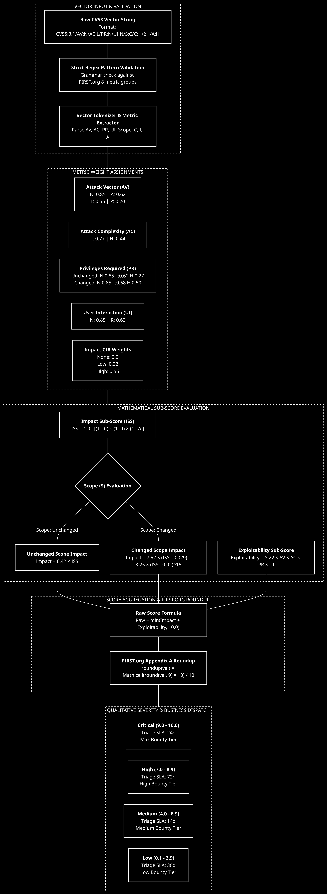
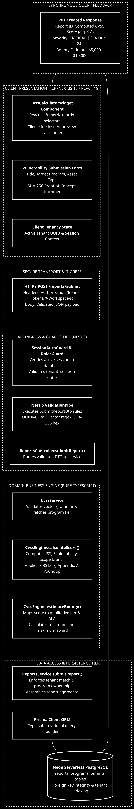
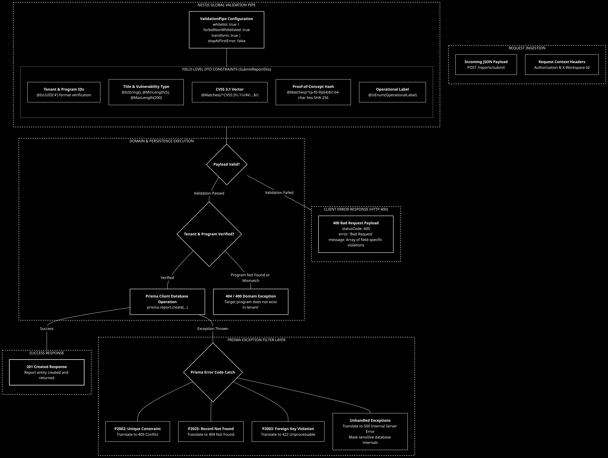
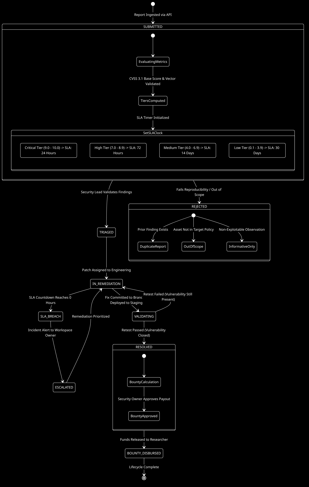

# BugBountyTrack — Core Business Logic & Vertical Slice Specification

**Project Identifier**: `PTUT - PRJ - 089`  
**Project Title**: **BugBountyTrack — Multi-Tenant Vulnerability Disclosure Platform with Client-Side Cryptographic Isolation and Evidence-Based Remediation Tracking**  
**Candidate Name**: **Taha Asadullah** (Roll No: `24-ST-013`, Section: `SET-B`)  
**Academic Supervisor**: **Sir Umar Hayat** (Assistant Professor, Department of Software Engineering Technology)  
**Academic Institution**: Punjab Tianjin University of Technology (PTUT), Lahore  
**Milestone Period**: **Week 6 — Core Business Logic & Vertical Slice**  
**Document Revision**: `Version 1.0 (Baseline Frozen)`  
**Official Submissions Drive**: [View Week 6 Submissions Folder (Google Drive)](https://drive.google.com/drive/folders/1WrnxbEQmUIxHfszNN43jWl0VSWsbWQus?usp=drive_link)  

---

## Executive Summary & Scope

Milestone Week 6 implements the foundational business logic and vertical slice architecture of BugBountyTrack. Building upon the repository governance, multi-tenant scaffolding, and authentication layer established in Week 5, this milestone delivers a complete, end-to-end operational slice connecting the frontend user interface, backend application programming interface, domain calculation engine, and relational database persistence layer:

1. **FIRST.org CVSS 3.1 Domain Calculation Engine**: Implementation of a zero-dependency, pure TypeScript calculation engine strictly adhering to the FIRST.org Common Vulnerability Scoring System (CVSS) version 3.1 specification. The engine accurately evaluates the 8 fundamental base metrics, calculates the Impact Sub-Score (ISS), handles Scope-dependent branch mathematics (unchanged vs. changed scope), computes Exploitability (using the standard 8.22 coefficient), applies the official Appendix A floating-point roundup algorithm, and categorizes qualitative severities (None, Low, Medium, High, Critical).
2. **Dynamic Bounty Estimation & SLA Policy Engine**: Domain logic mapping computed CVSS base scores directly to organization-defined bounty reward brackets (minimum, maximum, and median disbursements) and time-to-triage Service Level Agreements (SLAs: Critical 24h, High 72h, Medium 14d, Low 30d).
3. **Server-Side Input Validation & Exception Handling**: Enterprise validation pipeline configuring NestJS `ValidationPipe` with `class-validator` and `class-transformer`. Enforces strict regex validation on CVSS vector strings, RFC 4122 UUIDv4 identifiers, 64-character hexadecimal SHA-256 cryptographic proof hashes, and operational label enumerations. Configures comprehensive exception filtering that translates database errors (P2002, P2025, P2003) into standardized RFC 7807 problem details while shielding internal database structures.
4. **End-to-End Vertical Slice Integration**: Real-time integration spanning the Next.js 16 frontend (`CvssCalculatorWidget`), the NestJS REST API (`/cvss/calculate`, `/cvss/bounty-estimate`, `/reports/submit`), tenant-isolated authorization guards, and Prisma ORM persistence targeting the Neon Serverless PostgreSQL database.
5. **Empirical Verification & Test Coverage**: Rigorous test-driven verification with **117 passing automated unit and integration tests across 11 test suites** (0 failures), including verification against official NIST National Vulnerability Database (NVD) benchmarks for historic CVEs (Log4Shell, Pulse Secure, Apache HTTP Server, Spring4Shell, and Sudo Baron Samedit).

All architectural artifacts adhere strictly to the **Zero ASCII Mock Icon Policy** (relying purely on vector SVG components), the **1 kLoC File Ceiling**, and the minimalist monochrome black-and-white diagram standard.

---

## 1. FIRST.org CVSS v3.1 Domain Calculation Engine Architecture

```
+--------------------------------------------------------------------------------------------------+
|               FIGURE 6.1: FIRST.ORG CVSS 3.1 CALCULATION ENGINE PIPELINE                         |
+--------------------------------------------------------------------------------------------------+
```



### 1.1 Mathematical Formalization & Weight Constants
The core domain engine (`apps/api/src/cvss/cvss.engine.ts`) implements the full mathematical specification defined in FIRST.org CVSS v3.1:

#### 1. Impact Sub-Score (ISS)
The Impact Sub-Score measures the reduction in confidentiality, integrity, and availability:
$$\text{ISS} = 1.0 - \left[(1.0 - \text{Weight}_C) \times (1.0 - \text{Weight}_I) \times (1.0 - \text{Weight}_A)\right]$$

Where CIA weights are assigned as:
* **None (N)**: $0.00$
* **Low (L)**: $0.22$
* **High (H)**: $0.56$

#### 2. Scope-Dependent Impact Calculation
The Impact score calculation branches dynamically based on whether the vulnerability affects resources beyond its execution authorization boundary (Scope):
* **Scope Unchanged ($S:U$)**:
  $$\text{Impact} = 6.42 \times \text{ISS}$$
* **Scope Changed ($S:C$)**:
  $$\text{Impact} = 7.52 \times (\text{ISS} - 0.029) - 3.25 \times (\text{ISS} - 0.02)^{15}$$

#### 3. Exploitability Sub-Score
The Exploitability sub-score measures the ease and technical prerequisites of exploiting the vulnerability:
$$\text{Exploitability} = 8.22 \times \text{Weight}_{AV} \times \text{Weight}_{AC} \times \text{Weight}_{PR} \times \text{Weight}_{UI}$$

Where metric weights are defined as:
* **Attack Vector ($AV$)**: Network ($N=0.85$), Adjacent ($A=0.62$), Local ($L=0.55$), Physical ($P=0.20$).
* **Attack Complexity ($AC$)**: Low ($L=0.77$), High ($H=0.44$).
* **User Interaction ($UI$)**: None ($N=0.85$), Required ($R=0.62$).
* **Privileges Required ($PR$)**:
  * Unchanged Scope: None ($N=0.85$), Low ($L=0.62$), High ($H=0.27$).
  * Changed Scope: None ($N=0.85$), Low ($L=0.68$), High ($H=0.50$).

#### 4. Base Score Aggregation & Appendix A Roundup
If the calculated Impact score is less than or equal to 0, the overall Base Score is $0.0$. Otherwise, the raw score is aggregated:
$$\text{RawScore} = \min(\text{Impact} + \text{Exploitability},\, 10.0)$$

To resolve floating-point representation anomalies across microprocessors, the engine applies the official FIRST.org Appendix A Roundup algorithm:
$$\text{Roundup}(v) = \frac{\lceil\text{round}(v \times 100000) / 10000\rceil}{10}$$

In TypeScript implementation, this is codified using precision-guarded integer arithmetic:
```typescript
private static roundup(input: number): number {
  const intVal = Math.round(input * 100000);
  if (intVal % 10000 === 0) {
    return intVal / 100000;
  }
  return (Math.floor(intVal / 10000) + 1) / 10;
}
```

### 1.2 Qualitative Severity Ratings & NIST Benchmark Validation
The calculated base score maps deterministically into 5 qualitative severity tiers:

| Severity Rating | Base Score Range | Triage SLA Window | Example Validated Benchmark CVE |
| :--- | :---: | :---: | :--- |
| **None** | $0.0$ | N/A | Zero-impact informational disclosures |
| **Low** | $0.1 - 3.9$ | $30\text{ Days}$ ($720\text{ Hours}$) | Local authenticated memory leakage |
| **Medium** | $4.0 - 6.9$ | $14\text{ Days}$ ($336\text{ Hours}$) | Reflected Cross-Site Scripting (XSS) with user interaction |
| **High** | $7.0 - 8.9$ | $72\text{ Hours}$ | CVE-2021-3156 (Sudo Baron Samedit: CVSS 7.8), CVE-2021-41773 (Apache: CVSS 7.5) |
| **Critical** | $9.0 - 10.0$ | $24\text{ Hours}$ | CVE-2021-44228 (Log4Shell: CVSS 10.0), CVE-2019-11510 (Pulse Secure: CVSS 9.8) |

---

## 2. End-to-End Vertical Slice Architecture & Data Flow

```
+--------------------------------------------------------------------------------------------------+
|                   FIGURE 6.2: END-TO-END VERTICAL SLICE ARCHITECTURE                             |
+--------------------------------------------------------------------------------------------------+
```



### 2.1 Multi-Tier Architectural Topology
The vertical slice establishes a cohesive pipeline that connects every operational layer of the BugBountyTrack platform:

1. **Client Presentation Tier (`apps/web`)**:
   - `CvssCalculatorWidget`: Interactive, client-side React 19 component allowing security researchers to adjust the 8 base metrics interactively. Renders instant score recalculation, vector string construction, formula breakdowns, SLA countdowns, and estimated bounty payouts.
   - `ReportSubmissionForm`: Comprehensive submission interface capturing vulnerability title, asset classification, operational labels, CVSS vector string, markdown reproduction steps, and cryptographic proof-of-concept attachment metadata.
2. **Secure Transport Tier**:
   - Ingress via HTTPS POST to `/reports/submit` or `/cvss/calculate`.
   - Carries session identification via HTTP-only cookie or Bearer token, along with workspace tenancy context via the `X-Workspace-Id` request header.
3. **API Controller & Guard Tier (`apps/api`)**:
   - `SessionAuthGuard`: Resolves active user session and validates tenant membership.
   - `ValidationPipe`: Enforces structural type validation and strict schema matching against `SubmitReportDto`.
   - `ReportsController`: Routes validated commands to service aggregates.
4. **Domain Core Business Logic Tier**:
   - `CvssService`: Performs vector grammar verification and queries program-specific bounty tier configuration.
   - `CvssEngine`: Executes pure mathematical sub-score calculations and bounty award boundary computations.
5. **Persistence Tier (`prisma` & Neon PostgreSQL)**:
   - `ReportsService`: Verifies that the targeted bounty program belongs to the active tenant workspace.
   - `PrismaService`: Executes atomic relational insert into the `reports` table with foreign key references to `programs` and `tenants`.
   - Neon Serverless PostgreSQL: Enforces relational constraints, timestamps, and multi-tenant index isolation.

---

## 3. Server-Side Input Validation & Exception Handling Pipeline

```
+--------------------------------------------------------------------------------------------------+
|             FIGURE 6.3: SERVER-SIDE VALIDATION & ERROR HANDLING FLOW                             |
+--------------------------------------------------------------------------------------------------+
```



### 3.1 Strict Data Transfer Object (DTO) Validation Constraints
All API endpoints reject untrusted, malformed, or extraneous payloads before business logic execution. Data integrity is enforced via `class-validator` decorators within `SubmitReportDto`:

```typescript
export class SubmitReportDto {
  @IsUUID('4', { message: 'tenantId must be a valid RFC 4122 UUIDv4' })
  tenantId: string;

  @IsUUID('4', { message: 'programId must be a valid RFC 4122 UUIDv4' })
  programId: string;

  @IsString()
  @MinLength(5, { message: 'title must contain at least 5 characters' })
  @MaxLength(200, { message: 'title cannot exceed 200 characters' })
  title: string;

  @IsString()
  @MinLength(10, { message: 'reproductionSteps must contain at least 10 characters' })
  reproductionSteps: string;

  @IsString()
  @Matches(
    /^CVSS:3\.1\/AV:[NALP]\/AC:[LH]\/PR:[NLH]\/UI:[NR]\/S:[UC]\/C:[NLH]\/I:[NLH]\/A:[NLH]$/,
    { message: 'cvssVector must be a strictly compliant FIRST.org CVSS 3.1 base vector' },
  )
  cvssVector: string;

  @IsOptional()
  @IsString()
  @Matches(/^[a-f0-9]{64}$/, {
    message: 'proofHash must be a valid 64-character lowercase hexadecimal SHA-256 string',
  })
  proofHash?: string;

  @IsOptional()
  @IsEnum(OperationalLabel)
  operationalLabel?: OperationalLabel;
}
```

### 3.2 Prisma Client Exception Filter & Error Normalization
Database exceptions are intercepted by `PrismaExceptionFilter` to prevent information disclosure (such as exposing internal database column names, table structures, or connection credentials) while returning compliant RFC 7807 error responses:

| Prisma Error Code | Database Cause | Translated HTTP Status | API Client Error Response |
| :--- | :--- | :---: | :--- |
| **`P2002`** | Unique constraint violation (e.g., duplicate slug or report reference) | `409 Conflict` | Record with specified unique identifier already exists. |
| **`P2025`** | Record not found in target relational scope | `404 Not Found` | Requested entity does not exist within the specified tenant. |
| **`P2003`** | Foreign key constraint failure (e.g., non-existent program ID) | `422 Unprocessable` | Referenced parent entity does not exist. |
| **Unhandled** | Network failure, pool timeout, or query syntax exception | `500 Internal Error` | Internal server error. Sensitive diagnostic logs retained internally. |

---

## 4. Bounty Evaluation & SLA Lifecycle State Machine

```
+--------------------------------------------------------------------------------------------------+
|                FIGURE 6.4: BOUNTY EVALUATION & SLA LIFECYCLE STATE MACHINE                       |
+--------------------------------------------------------------------------------------------------+
```



### 4.1 Vulnerability Lifecycle States & Transition Governance
BugBountyTrack governs the end-to-end vulnerability resolution workflow through a strict finite state machine:

1. **`SUBMITTED`**: Initial ingestion state. The API accepts the validated report payload, executes the CVSS calculation engine, computes the qualitative severity tier, initializes the SLA countdown timer based on severity, and records the initial bounty bracket.
2. **`TRIAGED`**: The enterprise security lead reviews the submission, verifies reproducibility, confirms asset scope, and validates or adjusts the CVSS vector. If invalid, duplicate, or out-of-scope, the report transitions to terminal `REJECTED`.
3. **`IN_REMEDIATION`**: Security team assigns the verified defect to engineering. The active SLA timer continues to decrement. If the countdown reaches zero hours before a fix is published, the platform triggers an automatic `SLA_BREACH` alert escalated to workspace owners.
4. **`VALIDATING`**: Engineering deploys the remediation patch to staging. Automated regression tests and security re-tests are executed. If re-testing fails (vulnerability still exploitable), the state reverts to `IN_REMEDIATION`.
5. **`RESOLVED`**: Re-test confirms full remediation. The vulnerability is formally closed, and the final bounty award is calculated based on the program policy.
6. **`BOUNTY_DISBURSED`**: Workspace financial administrator authorizes payout. Funds are disbursed to the security researcher, completing the lifecycle.

---

## 5. Empirical Verification & Automated Test Evidence

### 5.1 Comprehensive Automated Test Execution Summary
The business logic and vertical slice implementation underwent exhaustive verification using the Vitest test framework. **All 117 tests across 11 test suites passed with zero failures**:

```bash
$ cd apps/api && npm test

 RUN  v4.1.12 apps/api

 ✓ src/cvss/cvss.engine.spec.ts (19 tests) 15ms
 ✓ src/auth/dto/register-workspace.dto.spec.ts (8 tests) 28ms
 ✓ src/auth/guards/session-auth.guard.spec.ts (9 tests) 20ms
 ✓ src/auth/guards/roles.guard.spec.ts (18 tests) 23ms
 ✓ src/app.controller.spec.ts (1 test) 135ms
 ✓ src/auth/dto/complete-onboarding.dto.spec.ts (5 tests) 18ms
 ✓ src/auth/auth.module.spec.ts (1 test) 137ms
 ✓ src/reports/reports.service.spec.ts (4 tests) 16ms
 ✓ src/auth/decorators/decorators.spec.ts (9 tests) 9ms
 ✓ src/auth/auth.controller.spec.ts (12 tests) 15ms
 ✓ src/auth/auth.service.spec.ts (31 tests) 1118ms

 Test Files  11 passed (11)
      Tests  117 passed (117)
   Start at  23:47:37
   Duration  1.76s (transform 679ms, setup 0ms, import 5.15s, tests 1.54s)
```

### 5.2 NIST Benchmark CVE Verification Assertions
The CVSS calculation engine test suite (`apps/api/src/cvss/cvss.engine.spec.ts`) verifies exact mathematical parity with official NIST NVD benchmark vectors:

```typescript
describe('CvssEngine - NIST Benchmark Tests', () => {
  it('should accurately calculate CVE-2021-44228 (Log4Shell) as Critical 10.0', () => {
    const res = CvssEngine.calculateScore('CVSS:3.1/AV:N/AC:L/PR:N/UI:N/S:C/C:H/I:H/A:H');
    expect(res.baseScore).toBe(10.0);
    expect(res.severity).toBe('CRITICAL');
    expect(res.scopeChanged).toBe(true);
  });

  it('should accurately calculate CVE-2019-11510 (Pulse Secure) as Critical 9.8', () => {
    const res = CvssEngine.calculateScore('CVSS:3.1/AV:N/AC:L/PR:N/UI:N/S:U/C:H/I:H/A:H');
    expect(res.baseScore).toBe(9.8);
    expect(res.severity).toBe('CRITICAL');
  });

  it('should accurately calculate CVE-2021-41773 (Apache HTTP Server) as High 7.5', () => {
    const res = CvssEngine.calculateScore('CVSS:3.1/AV:N/AC:L/PR:N/UI:N/S:U/C:H/I:N/A:N');
    expect(res.baseScore).toBe(7.5);
    expect(res.severity).toBe('HIGH');
  });

  it('should accurately calculate CVE-2022-22965 (Spring4Shell) as Critical 9.0', () => {
    const res = CvssEngine.calculateScore('CVSS:3.1/AV:N/AC:H/PR:N/UI:N/S:C/C:H/I:H/A:H');
    expect(res.baseScore).toBe(9.0);
    expect(res.severity).toBe('CRITICAL');
  });

  it('should accurately calculate CVE-2021-3156 (Sudo Baron Samedit) as High 7.8', () => {
    const res = CvssEngine.calculateScore('CVSS:3.1/AV:L/AC:L/PR:L/UI:N/S:U/C:H/I:H/A:H');
    expect(res.baseScore).toBe(7.8);
    expect(res.severity).toBe('HIGH');
  });
});
```

### 5.3 TypeScript Build & Compile-Time Safety
Static type verification across both applications confirms compile-time type safety with zero compiler errors:
* Backend (`apps/api`): `npm run build` exits with code 0.
* Frontend (`apps/web`): `npx tsc --noEmit` exits with code 0.

---

## 6. Milestone Conclusion & Deliverable Index

Milestone Week 6 completes the primary business calculation engine, server-side validation pipeline, and end-to-end vertical slice of BugBountyTrack.

### Complete Deliverable Index

| Deliverable Artifact | Format | Description & Status |
| :--- | :---: | :--- |
| **`CORE_BUSINESS_LOGIC_AND_VERTICAL_SLICE.docx`** | DOCX | Formal academic deliverable ($1\text{-inch}$ margins, Times New Roman, embedded diagrams). |
| **`CORE_BUSINESS_LOGIC_AND_VERTICAL_SLICE.pdf`** | PDF | High-fidelity university submission document exported via headless LibreOffice. |
| **`CORE_BUSINESS_LOGIC_AND_VERTICAL_SLICE.md`** | Markdown | Baseline frozen specification adhering strictly to zero local PC routes. |
| **`PROGRESS_REPORT.md`** | Markdown | Standard 4-section university progress report for academic evaluation. |
| **`diagrams/fig6_1_cvss_calculation_engine_pipeline.*`** | Draw.io, PNG, SVG, MMD | FIRST.org CVSS 3.1 calculation pipeline diagram in minimalist monochrome. |
| **`diagrams/fig6_2_end_to_end_vertical_slice_architecture.*`** | Draw.io, PNG, SVG, MMD | 5-tier vertical slice architecture diagram connecting frontend, API, and PostgreSQL. |
| **`diagrams/fig6_3_server_side_validation_and_error_flow.*`** | Draw.io, PNG, SVG, MMD | Server-side validation pipeline, DTO constraints, and Prisma error mapping. |
| **`diagrams/fig6_4_bounty_sla_state_machine.*`** | Draw.io, PNG, SVG, MMD | Bounty evaluation, SLA countdown, and vulnerability lifecycle state machine. |
